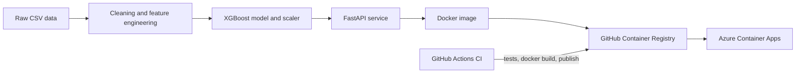

# ChurnGuard: Customer Churn Prediction API

[](https://github.com/dushanth-001/churnguard/actions/workflows/ci.yml)

A machine learning service that scores how likely a telecom customer is to churn, so a retention team can decide who to contact first. The project covers the full path from raw data to a tested, containerised and cloud-deployed API.

## Business framing

- **Who uses it:** an internal retention team, not the customers themselves.
- **Decision it supports:** which customers get a retention call or offer.
- **Why recall:** a missed churner costs more than an unnecessary offer, so the model is tuned for recall rather than accuracy. The dataset is imbalanced (about 26.5% churn), so accuracy alone is misleading: a model that always predicts "no churn" is already about 73.5% accurate.

## Results (held-out test set)

Measured with `python src/evaluate.py` on 1057 customers (evaluated on 2026-10-29), decision threshold 0.5.

| Metric | Value |
|---|---|
| Recall | 79.0% |
| Precision | 51.1% |
| F1 | 0.62 |
| Accuracy | 74.4% |
| ROC AUC | 0.841 |

Of the 281 customers who actually churned in the test set, the model flagged 222 and missed 59. It also flagged 212 customers who did not churn (false alarms), which is the price paid for higher recall.

Model: XGBoost. Hyperparameters were chosen with randomized search scored on recall, and class imbalance is handled with `scale_pos_weight`.

### How the model was chosen

Validation-set results from the exploration phase (the exploration notebook is not included in this repository):

| Model | Recall | Precision |
|---|---|---|
| Logistic Regression (baseline) | 0.59 | 0.65 |
| Logistic Regression + class weight | 0.81 | 0.51 |
| Random Forest (tuned) | 0.85 | 0.51 |
| XGBoost (tuned) | 0.86 | 0.52 |

SHAP analysis during exploration pointed to contract type, tenure, fibre-optic internet, electronic-check payment and monthly charges as the strongest churn drivers.

## Architecture



## Run it locally

```bash
docker run -p 8000:8000 -e API_KEY=choose-a-secret ghcr.io/dushanth-001/churnguard:latest
```

Open http://localhost:8000/docs for the interactive API page.

## API

| Endpoint | Auth | Purpose |
|---|---|---|
| `GET /` | none | health check |
| `POST /predict` | `X-API-Key` header | churn prediction for one customer |

`/predict` rejects requests without the correct key. If the `API_KEY` environment variable is not set, it rejects every request (it fails closed). Inputs are validated: binary features must be 0 or 1.

```bash
curl -X POST http://localhost:8000/predict \
  -H "Content-Type: application/json" \
  -H "X-API-Key: choose-a-secret" \
  -d @examples/sample_request.json
```

Example response (values for the sample request):

```json
{"churn_prediction": 1, "churn_probability": 0.848}
```

## Project structure

```text
app.py                               FastAPI application
src/
├── data_preprocessing.py            Cleaning and feature engineering
├── train.py                         Training and tuning functions
├── evaluate.py                      Test-set evaluation, writes metrics.json
├── predict.py                       Model loading and prediction helpers
└── logger.py                        Logging setup
models/                              Trained model and scaler
tests/                               Unit tests and API tests
examples/                            Sample API request
.github/workflows/                   CI pipeline
Dockerfile
config.yaml                          Settings reference
metrics.json                         Latest test-set metrics
``` 

## Testing and CI

Every push to `main` runs three jobs in GitHub Actions:

1. `test`: installs pinned dependencies in a clean environment and runs pytest.
2. `docker`: builds the image, starts the container and checks that the API responds.
3. `publish`: pushes the image to GitHub Container Registry (only after the first two pass).

## Limitations

- The data is the public IBM Telco dataset, not real company data.
- The decision threshold is fixed at 0.5. With real cost figures for a missed churner and a retention offer, the threshold should be chosen from those costs.
- The API expects already-encoded features, and `tenure`, `MonthlyCharges` and `TotalCharges` must already be standardised. A production version would accept raw customer fields and apply the saved scaler inside the service.
- The model was trained once. There is no drift monitoring or automated retraining yet.
- The demo deployment runs on a free-tier plan that scales to zero, so the first request after idle time is slow.

## Roadmap

- Drift monitoring and scheduled retraining
- A prediction endpoint that accepts raw customer fields
- Threshold selection from business cost data
